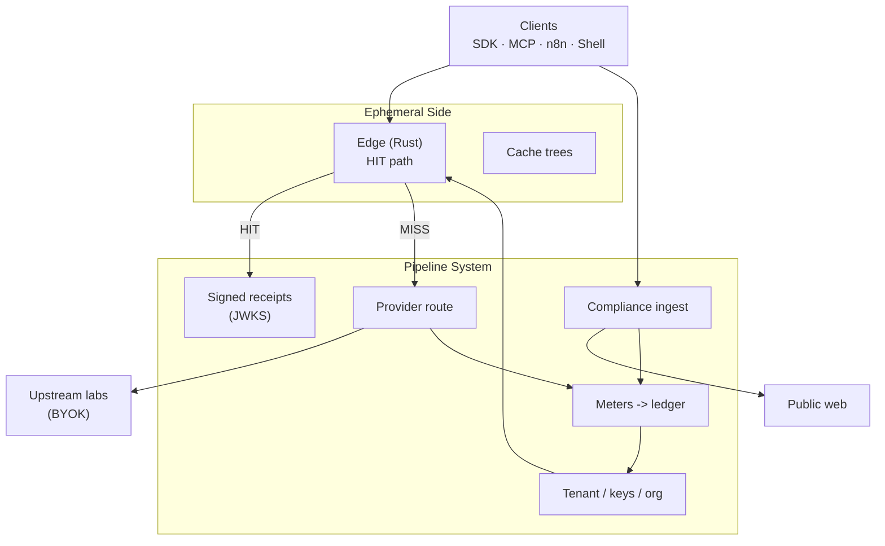

# Metrecept — open client tools

[](LICENSE)
[](https://metrecept.co.uk)
[](https://api.metrecept.co.uk/health)

**Metrecept is the black box for autonomous AI agents.** Point any OpenAI-compatible client (or Cursor) at one base URL. Keep your keys. Every call that crosses the pipe — a model completion, a compliant web fetch, an agent's mid-session call to a third-party API — becomes a cryptographically signed, independently verifiable receipt.

Exact-replay hits that cost zero upstream tokens are the plumbing that makes that metering — and therefore the receipt — possible at all. Savings are real and billed the same as always; they are the second sentence, not the first.

> Trust should never need to incur transactional debt. The signed receipt is a free byproduct of the pipe running, not a feature you rent back at a markup.

**Site:** https://metrecept.co.uk · **API:** https://api.metrecept.co.uk/v1 · **Docs:** https://metrecept.co.uk/docs · **One-click Cursor attach:** https://metrecept.co.uk/i

---

## What's in this repo

This is the **public, MIT-licensed** half of Metrecept — client-side tools plus a redacted architectural tour of the hosted pipe. Nothing here requires trusting prose: every claim below links to a command you can run yourself.

| Path | What it is |
|------|------------|
| [`docs/`](docs/) | Architecture exhibition — how the pipe is built, what a signed receipt is, how compliant web fetch works, why this shape instead of a routing proxy |
| [`demo/`](demo/) | Runnable scripts that prove the claims against the **live** hosted API — no Metrecept package required to verify a receipt |
| [`sdks/python/`](sdks/python/) | Python OpenAI `base_url` helper (`at-utility-sdk` on PyPI — legacy package name) |
| [`sdks/typescript/`](sdks/typescript/) | TypeScript/JS helper (`@at-utility/sdk` on npm — legacy package name) |
| [`packages/ohm-mcp/`](packages/ohm-mcp/) | MCP server for Cursor / Claude (`withohm-mcp` on PyPI — legacy package name). Tools: `metrecept_*`, `metre_*`, and `ohm_*` |
| [`packages/n8n-nodes-metrecept/`](packages/n8n-nodes-metrecept/) | n8n community node — Chat / Verify / Usage with inline receipt checks |
| [`templates/`](templates/) | Ready-to-clone agent and CI integration templates |
| [`skills/`](skills/) | Cursor skills for the MCP tools |
| [`plugin.json`](plugin.json) · [`mcp.json`](mcp.json) | Agent-plugin / MCP attach manifests |

## What's *not* in this repo

The gateway (`gateway-rs` Rust edge + Python control plane), the cache/replay engine internals, the adaptive model routing, and the billing/compliance core are **proprietary** and stay closed — no self-hosting option, and that is a deliberate, permanent split, not a staged reveal. What's below is a genuine architectural tour of *how* the pipe is shaped and *what* it commits to publicly, not a copy of the implementation. See [LICENSE](LICENSE) and [NOTICE](NOTICE) for the exact split.

## Names that have not migrated yet

The product, site, and API host are Metrecept. A few identifiers still use the previous names, on purpose, until a coordinated cutover — they are not the customer destination:

| What you type | What it is |
|---------------|------------|
| `sk-at-…` | Tenant API key prefix (legacy). There is no `sk-metre-` prefix yet. |
| `X-Ohm-*` / `X-Metrecept-*` | Request/response headers. Both work; new wins if both are sent. Receipts dual-emit as `X-Ohm-Receipt` and `X-Metrecept-Receipt`. |
| `withohm-mcp` / `ohm-mcp` | Distribution name (not on PyPI yet) and stdio command. Install from GitHub, then run `ohm-mcp`. |
| `at-utility-sdk` / `@at-utility/sdk` | Client SDK package names until first publish-under-new-name. |
| `OHM_API_KEY` / `OHM_BASE_URL` | Env vars the MCP server actually reads. |

Neither `withohm-mcp` nor `metrecept-mcp` is on PyPI yet. `ohm-mcp` on PyPI is someone else's refactoring tool.

## Architecture at a glance



One OpenAI-compatible ingress. Two containers that meet at every request on a named crossing — **HIT or MISS** — that's always metered and, on HIT, receipted. The black box records the crossing; it does not stop a bad agent call before it happens. Full walkthrough: [`docs/ARCHITECTURE.md`](docs/ARCHITECTURE.md).

## Verify it yourself

Prose is cheap; every claim below ships with the command that checks it against the **live, hosted pipe**.

| Claim | Check |
|-------|---------|
| The pipe is up | `curl -s https://api.metrecept.co.uk/health && curl -s https://api.metrecept.co.uk/ready` |
| Hits replay and are billed as hits | Send the same body twice — second response has `X-AT-Cache: HIT` + `X-AT-Billed-USD` — see [`demo/hit_miss_demo.sh`](demo/hit_miss_demo.sh) |
| **A hit is cryptographic, not asserted** | Hit responses carry `X-Ohm-Receipt` / `X-Metrecept-Receipt` (signed JWS) — verify with zero Metrecept code: `python demo/verify_receipt.py "<receipt>"` — see [`docs/RECEIPTS.md`](docs/RECEIPTS.md) |
| Signing keys are public | `curl -s https://api.metrecept.co.uk/.well-known/http-message-signatures-directory` |
| Published limits and refusals | `curl -s https://api.metrecept.co.uk/v1/public/honesty` — what the pipe won't do, with the endpoint that proves each item |
| Cross-tenant savings counter | `curl -s https://api.metrecept.co.uk/v1/public/stats` (always `estimate_only: true`) |

## Quickstart

Get a free key ($0 seat, no card) at [metrecept.co.uk/billing/intermediate](https://metrecept.co.uk/billing/intermediate), then:

**OpenAI-compatible client**

```python
from at_utility_sdk import openai_client

client = openai_client("sk-at-...", base_url="https://api.metrecept.co.uk/v1")
completion = client.chat.completions.create(
    model="mock",  # or gpt-*/claude-*/etc. with X-Ohm-Upstream-Key (BYOK)
    messages=[{"role": "user", "content": "Hello"}],
)
```

**Cursor / MCP**

Hosted (no install): `https://api.metrecept.co.uk/mcp` with `Authorization: Bearer sk-at-…`. One-click attach: [metrecept.co.uk/i](https://metrecept.co.uk/i).

Stdio from this repo (the name `withohm-mcp` is not on PyPI yet — `ohm-mcp` on PyPI is an unrelated third-party package):

```bash
pip install "git+https://github.com/iwasinnam2/metrecept-opensource.git#subdirectory=packages/ohm-mcp"
```

```json
{
  "mcpServers": {
    "metrecept": {
      "command": "ohm-mcp",
      "env": {
        "OHM_API_KEY": "sk-at-YOUR_ISSUED_KEY",
        "OHM_BASE_URL": "https://api.metrecept.co.uk/v1"
      }
    }
  }
}
```
```

Or jump straight to the proof: [`demo/`](demo/) walks through cache MISS → HIT → a verified receipt in under a minute.

## Read next

- [`docs/ARCHITECTURE.md`](docs/ARCHITECTURE.md) — the Ephemeral Side / Pipeline System split, HIT and MISS sequence diagrams
- [`docs/CACHE_TREES.md`](docs/CACHE_TREES.md) — branchable exact-replay inventory, and the honesty note on what's shipped vs. not
- [`docs/RECEIPTS.md`](docs/RECEIPTS.md) — the signed cache-hit receipt, field by field
- [`docs/COMPLIANCE.md`](docs/COMPLIANCE.md) — the purpose-bound, robots-aware, PII-redacting web fetch gate
- [`docs/POSITIONING.md`](docs/POSITIONING.md) — why this shape instead of a routing proxy or provider-native caching
- [`docs/GLOSSARY.md`](docs/GLOSSARY.md) — black box, HIT/MISS, receipt, pipe rent, BYOK in one page

## License

MIT (see [`LICENSE`](LICENSE)). This repo is a periodically-synced mirror of the public-facing directories in Metrecept's private monorepo, not the primary development location — see [CONTRIBUTING.md](CONTRIBUTING.md) and the per-directory `LICENSE` files.
