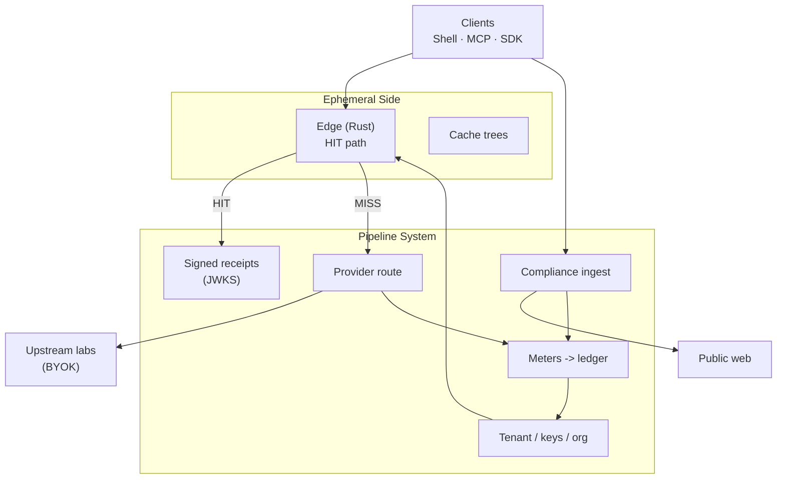

# Metrecept — open client tools

**Proof, not trust.** Metrecept issues a signed Ed25519 receipt (compact JWS) for every call an autonomous AI agent makes through it — model completions, compliant public-web fetches, and calls to third-party business APIs — and can roll a whole agent run into one signed session receipt. Anyone can verify a receipt against Metrecept's published public keys, with no account and no Metrecept code.

Metrecept is a **recorder, not a governor**: it does not stop a bad call, and a receipt does not grade the work. It proves what was called, when, and what it cost. It is built for **autonomous AI agent companies** that need a record a customer or auditor can check, and for **stablecoin and settlement firms** that need a verifiable record of each agent-initiated call.

**Site:** https://metrecept.co.uk · **API:** https://api.metrecept.co.uk/v1 · **Docs:** https://metrecept.co.uk/docs

---

> **Ohm is a sibling brand name of Metrecept; some identifiers keep the ohm prefix for compatibility.** These are: the `ohm-mcp` and `ohm-mcp-http` commands and the `ohm_mcp` Python import name (aliases of `metrecept-mcp`, `metrecept-mcp-http` and `metrecept_mcp`); `OHM_*` environment variables (`OHM_API_KEY`, `OHM_BASE_URL`, `OHM_UPSTREAM_KEY`, `OHM_SERVICE_KEY`, `OHM_MCP_*`), read by the MCP server only when the matching `METRECEPT_*` variable is unset; the `api.withohm.dev` and `mcp.withohm.dev` hostnames in the MCP server's host allowlist; and the `X-Ohm-*` headers the hosted gateway still accepts and emits next to their `X-Metrecept-*` equivalents. This client sends only `X-Metrecept-*` headers. Use the Metrecept names in new setups.

## What's in this repo

This is the **public, MIT-licensed thin client** for Metrecept — an MCP server (14 `metrecept_*` tools), Python and TypeScript SDK helpers, an n8n node, receipt verifiers and demos, plus a redacted tour of the architecture behind the hosted gateway. The hosted gateway is proprietary, and every real call needs a Metrecept API key. Nothing here requires trusting prose: every claim below links to a command you can run yourself.

| Path | What it is |
|------|------------|
| [`docs/`](docs/) | Architecture exhibition — how the gateway is built, what a signed receipt is, how compliant web fetch works, why this shape instead of a routing proxy |
| [`demo/`](demo/) | Runnable scripts that prove the claims against the **live** hosted API — no Metrecept code required to verify a receipt |
| [`sdks/python/`](sdks/python/) | Python OpenAI `base_url` helper (`at-utility-sdk` on PyPI) |
| [`sdks/typescript/`](sdks/typescript/) | TypeScript/JS helper (`@at-utility/sdk` on npm) |
| [`packages/metrecept-mcp/`](packages/metrecept-mcp/) | MCP server for Cursor/Claude agents (`pip install metrecept-mcp`; command `metrecept-mcp`) |
| [`templates/`](templates/) | Ready-to-clone agent integration templates |
| [`actions/receipt-link/`](actions/receipt-link/) | GitHub Action: comment the run's signed session receipt on a pull request as a link (`https://metrecept.co.uk/verify#<jws>`) — whoever opens it checks the Ed25519 signature in their browser against the public key directory, no account |

## What's *not* in this repo

The gateway (`gateway-rs` Rust edge + Python control plane), the cache engine internals, the adaptive model routing, and the billing/compliance core are **proprietary** and stay closed — no self-hosting option, and that's a deliberate, permanent split, not a staged reveal. What's below is a genuine architectural tour of *how* the gateway is shaped and *what* it commits to publicly, not a copy of the implementation. See [LICENSE](LICENSE) and [NOTICE](NOTICE) for the exact split.

## Architecture at a glance



One OpenAI-compatible ingress. Every call is metered and signed: the response carries a receipt you can verify independently. Exact repeats can be served from the tenant's cache. Full walkthrough: [`docs/ARCHITECTURE.md`](docs/ARCHITECTURE.md).

## Verify it yourself

Prose is cheap; every claim below ships with the command that checks it against the **live, hosted gateway** — nothing in this table depends on trusting this README.

| Claim | Check |
|-------|-------|
| The gateway is up | `curl -s https://api.metrecept.co.uk/health && curl -s https://api.metrecept.co.uk/ready` |
| Exact repeats are served from cache and billed as hits | Send the same body twice — second response has `X-AT-Cache: HIT` + `X-AT-Billed-USD` — see [`demo/hit_miss_demo.sh`](demo/hit_miss_demo.sh) |
| **Every call carries a signed receipt** | Responses carry a signed JWS receipt header (`X-Metrecept-Receipt`, legacy `X-Metrecept-Receipt`) — verify with zero Metrecept code: `python demo/verify_receipt.py "<receipt>"` — see [`docs/RECEIPTS.md`](docs/RECEIPTS.md) |
| **The bytes you got are the bytes the receipt names** | Crossing receipts may carry `response_sha256`. Recompute it from your own capture with zero Metrecept code: `python demo/response_digest.py body.json` for a JSON body, `python demo/response_digest.py --sse stream.txt` for the raw stream you received (the gateway's assembly rule is in the file). A stream that never finished carries no digest |
| Signing keys are public | `curl -s https://api.metrecept.co.uk/.well-known/http-message-signatures-directory` |
| **The run's receipt is a link a stranger can open** | Tag calls with `X-Metrecept-Session: <id>`, then `GET /v1/sessions/<id>` returns a signed `kind: "session"` receipt. Put it after `https://metrecept.co.uk/verify#` and send the link: the Ed25519 check runs in the browser against the directory above, no account. The session receipt is $0. It proves Metrecept signed this record of the run; it does not grade the work, and it did not stop anything |
| Published limits and refusals | `curl -s https://api.metrecept.co.uk/v1/public/honesty` — what the gateway won't do, with the endpoint that proves each item |
| Cross-tenant savings counter | `curl -s https://api.metrecept.co.uk/v1/public/stats` (always `estimate_only: true`) |

## Quickstart

Every real call needs an API key. Get one ($0 seat, no card) at [metrecept.co.uk/billing/intermediate](https://metrecept.co.uk/billing/intermediate), then:

```python
from at_utility_sdk import openai_client

client = openai_client("sk-at-...", base_url="https://api.metrecept.co.uk/v1")
completion = client.chat.completions.create(
    model="mock",  # or gpt-*/claude-*/etc. with your own upstream key (BYOK)
    messages=[{"role": "user", "content": "Hello"}],
)
```

Or jump straight to the proof: [`demo/`](demo/) makes a call, captures its receipt and verifies it in under a minute.

## Read next

- [`docs/ARCHITECTURE.md`](docs/ARCHITECTURE.md) — how the hosted gateway is shaped, with request sequence diagrams
- [`docs/CACHE_TREES.md`](docs/CACHE_TREES.md) — named cache namespaces for exact repeats, and what's shipped vs. not
- [`docs/RECEIPTS.md`](docs/RECEIPTS.md) — the signed receipt, field by field, and how to verify it
- [`docs/COMPLIANCE.md`](docs/COMPLIANCE.md) — the purpose-bound, robots-aware, PII-redacting web fetch gate
- [`docs/POSITIONING.md`](docs/POSITIONING.md) — what Metrecept is, who it is for, and what it is not
- [`docs/GLOSSARY.md`](docs/GLOSSARY.md) — receipt, session, JWKS, HIT/MISS, BYOK in one page

## License

MIT (see [`LICENSE`](LICENSE)). This repo is a periodically-synced mirror of the public-facing directories in Metrecept's private monorepo, not the primary development location — see the per-directory `LICENSE` files.
